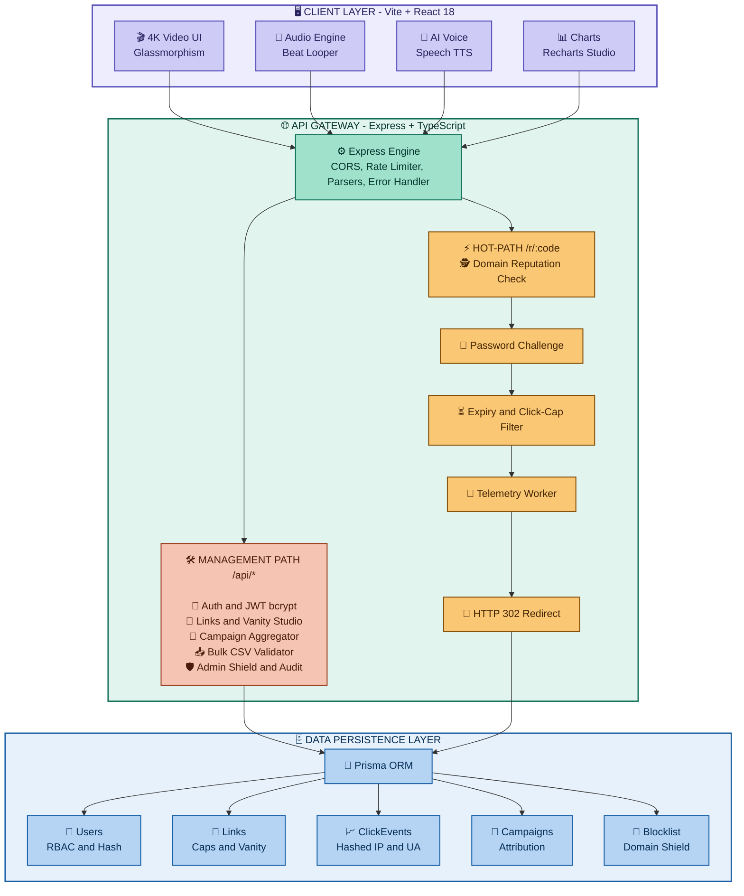
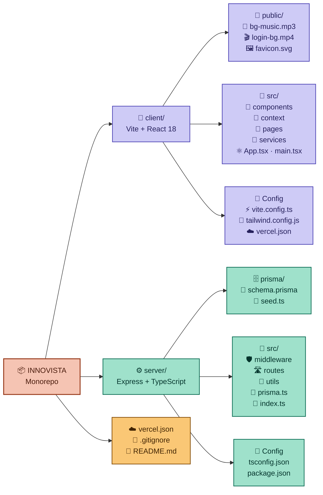

<div align="center">

# ⚡ LinkPulse (INNOVISTA)
### Enterprise Edge Link Infrastructure, Atomic Redirects & Real-Time Telemetry

[](https://react.dev/)
[](https://nodejs.org/)
[](https://www.prisma.io/)
[](https://tailwindcss.com/)
[](https://vercel.com/)
[](https://opensource.org/licenses/MIT)

<p align="center">
  <b>A production-grade, high-throughput URL infrastructure designed for ultra-low latency edge redirects, GDPR-compliant privacy analytics, cryptographic security barriers, dynamic vector QR generation, and autonomous AI voice telemetry.</b>
</p>

[Key Features](#-core-capabilities) • [System Architecture](#-system-architecture) • [Audio & AI Engine](#-multimedia--ai-audio-engine) • [API Reference](#-api-specification) • [Deployment](#-quickstart--deployment) • [Credentials](#-demo-credentials)

---

</div>


# Deployed Link ~ 

https://innovista-black.vercel.app/


# Prototype ~ 


# Dashboard ~ 


## 📌 Executive Summary

Modern link routing is more than a simple HTTP `302` redirect. Enterprise platforms require **atomic click enforcement**, **zero-latency destination lookup**, **fraud/malware domain screening**, **campaign attribution funnels**, and **deep privacy-preserving analytics** without relying on invasive client-side cookies.

**LinkPulse** is engineered as a resilient full-stack platform that delivers:
- **Sub-15ms Hot-Path Redirection (`/r/:code`)** with atomic click increments.
- **Privacy-First Telemetry Engine** using daily salted SHA-256 IP hashing and User-Agent heuristic parsing.
- **Dynamic Vector QR Studio** rendering scalable vector QR matrices with scan-attribution tags.
- **Automated Security Shield** with domain reputation screening and password-protected enclaves.
- **Immersive 4K Sci-Fi Interface** powered by Web Audio synth loops and Web Speech API narration.

---

## 🏛 System Architecture

## 🏛 System Architecture


## ⚡ Redirection Sequence & Telemetry Lifecycle

```
User (Browser)               LinkPulse Gateway                Prisma DB             Destination
      │                              │                            │                      │
      │── 1. GET /r/ph-launch ───────►│                            │                      │
      │                              │── 2. Query Link & Rules ──►│                      │
      │                              │◄── Return Link Record ─────│                      │
      │                              │                            │                      │
      │                              │── 3. Validate Constraints: │                      │
      │                              │   • Is Link Active?        │                      │
      │                              │   • Has Link Expired?      │                      │
      │                              │   • Has Click Cap Hit?     │                      │
      │                              │   • Is Destination Safe?   │                      │
      │                              │                            │                      │
      │                              │── 4. Atomic Increment ────►│                      │
      │                              │   & Asynchronous Telemetry:│                      │
      │                              │   • Hash IP: SHA256(IP+Day)│                      │
      │                              │   • Parse UA: Device/OS    │                      │
      │                              │   • Track Country/Referrer │                      │
      │                              │                            │                      │
      │◄── 5. HTTP 302 Found ────────│                            │                      │
      │       Location: destination  │                            │                      │
      │                              │                            │                      │
      │──────────────────────────────┼────────────────────────────┼─────────────────────►│
      │                              │                            │    Follow 302        │
```

---

## 🚀 Core Capabilities

<div align="center">


</div>

<br/>

<table>
<tr>
<td width="50%" valign="top">

### ⚡ 1. Sub-15ms Atomic Hot-Path
 

- 🧮 Optimized DB transactions give **atomic click counting** with zero race conditions during traffic spikes
- 🚧 **Hard-cap enforcement** blocks traffic the moment a link hits its limit
- ⏳ Temporary or permanent **expiry timestamps** stop stale URL forwarding

</td>
<td width="50%" valign="top">

### 🔐 2. Cryptographic Security Barrier
 

- 🔑 Gate sensitive destinations behind a **password challenge**
- 🪟 Branded **frosted-glass interstitial** is shown before forwarding
- 🛂 Only verified visitors reach the destination

</td>
</tr>
<tr>
<td width="50%" valign="top">

### 🕵️ 3. GDPR-Compliant Privacy Telemetry
 

- 🚫 **Zero raw PII storage**: IPs are never saved in plain text
- 🔒 One-way hash `SHA-256(IP + SALT + Date)` counts **unique visitors** without cross-session tracking
- 📱 User-Agent parser detects **Desktop, Mobile, Tablet, Bot**, OS and browser engine

</td>
<td width="50%" valign="top">

### 🔳 4. Dynamic Vector & Raster QR Studio
 

- 🎨 Live rendering of high-precision **SVG** and high-resolution **PNG** QR codes
- 🏷️ Embedded **scan attribution** (`?src=qr`) separates physical scans from digital clicks
- 📥 Download ready for print or web

</td>
</tr>
<tr>
<td width="50%" valign="top">

### 🎯 5. Multi-Channel Campaign Funnels
 

- 🗂️ Organize links into campaigns like `Q4 Launch`, `Black Friday`, `Influencer Outreach`
- 📊 Compare **traffic and conversion** performance across distribution channels

</td>
<td width="50%" valign="top">

### 📥 6. High-Speed Bulk CSV Ingestion
 

- 📄 Upload multi-column CSV files with **thousands of target URLs**
- ✅ Client-side matrix checks syntax and detects **duplicate aliases**
- 🧾 Formatting errors are reported **before submission**

</td>
</tr>
<tr>
<td colspan="2" valign="top">

### 🛡️ 7. Automated Domain Shield
 

- 🚫 Platform-wide blocklist keeps **phishing, malware and scam domains** out of the redirection pipeline
- 👑 Admins can add malicious domains instantly from the Admin panel

</td>
</tr>
</table>

---
## 🎙 Multimedia & AI Audio Engine

LinkPulse features an audio and visual presentation layer on the Login and Onboarding views:

| Feature | Technical Implementation | Behavior |
| :--- | :--- | :--- |
| **4K Cosmic Background** | Native HTML5 Video Canvas with hardware-accelerated CSS filters (`contrast`, `saturate`, `brightness`). | Continuous seamless loop with trailing 3-second auto-trim. |
| **Trap Beat Looper** | Custom HTML5 Audio Engine (`/bg-music.mp3`). | Auto-loops continuously; precision 40ms interval crops last 3 seconds to maintain tight rhythm. |
| **Autonomous AI Voice** | Browser Web Speech API (`SpeechSynthesisUtterance`). | Synthesizes calm AI narration (rate `0.95`, pitch `0.92`) introducing LinkPulse capabilities 3 seconds after music starts. |
| **Smart Audio Ducking** | Dynamic gain & volume scaling (`0.38` ➔ `0.16`). | Reduces music volume during AI narration so voice output remains crystal clear. |
| **Sound State Protection** | Memory-backed `isMutedRef` + gesture event lifecycle. | Guarantees clicking "Sound Off" cleanly stops playback and prevents accidental auto-resumption. |

---

## 🛠 Tech Stack Specification

### Frontend
- **Framework**: React 18.3 with TypeScript
- **Tooling & Bundler**: Vite 8.3
- **Styling**: Tailwind CSS, PostCSS, Custom Glassmorphism Theme
- **Data Visualization**: Recharts (Area, Bar, Pie, Responsive Containers)
- **Icons**: Lucide React
- **HTTP Client**: Axios with automated JWT auth interceptors

### Backend
- **Runtime**: Node.js (v18+)
- **Application Framework**: Express.js with TypeScript
- **ORM**: Prisma ORM (v5+)
- **Database**: SQLite (Development) / PostgreSQL (Production ready)
- **Security**: JSON Web Tokens (JWT), bcryptjs (Salt factor 10), Express Rate Limiter
- **Telemetry Parsers**: UAParser.js, Node.js Crypto (SHA-256)

---


# Road Map ~


## 📂 Project Directory Structure




## 📡 API Specification

## 📡 API Reference

<div align="center">


&nbsp;│&nbsp;


</div>

### 🔐 Authentication

| Method | Endpoint | Access | What it does |
|:---:|:---|:---:|:---|
|  | `/api/auth/register` |  | 📝 Create new account with hashed password |
|  | `/api/auth/login` |  | 🔑 Authenticate user & return signed JWT |
|  | `/api/auth/me` |  | 👤 Fetch current user session profile |

### ⚡ Redirect Engine (Hot-Path)

| Method | Endpoint | Access | What it does |
|:---:|:---|:---:|:---|
|  | `/r/:code` |  | 🚀 **Hot-path**: process redirect, record telemetry, return `302` |
|  | `/r/:code/verify` |  | 🔒 Verify password for protected links |

### 🔗 Links Management

| Method | Endpoint | Access | What it does |
|:---:|:---|:---:|:---|
|  | `/api/links` |  | 📋 List all active links of current user |
|  | `/api/links` |  | ✨ Create short link with optional rules & campaign |
|  | `/api/links/:id` |  | ✏️ Update destination, click-cap or expiry |
|  | `/api/links/:id` |  | 🗑️ Deactivate / remove link |

### 📊 Analytics & Campaigns

| Method | Endpoint | Access | What it does |
|:---:|:---|:---:|:---|
|  | `/api/analytics/overview` |  | 📈 Total clicks, top link, device breakdown |
|  | `/api/analytics/:id` |  | 🔍 Granular timeseries for a single link |
|  | `/api/campaigns` |  | 🎯 List campaigns with aggregated metrics |
|  | `/api/campaigns` |  | 🏷️ Create marketing campaign grouping |

### 📥 Bulk Import

| Method | Endpoint | Access | What it does |
|:---:|:---|:---:|:---|
|  | `/api/bulk/import` |  | 📦 Ingest & validate batch CSV link entries |

### 👑 Admin Shield

| Method | Endpoint | Access | What it does |
|:---:|:---|:---:|:---|
|  | `/api/admin/metrics` |  | 🛰️ Platform-wide traffic & infrastructure stats |
|  | `/api/admin/blocklist` |  | 🚫 Add domain to malicious blocklist |

---

## 🚀 Quickstart & Deployment

### Prerequisites
- Node.js 18.x or higher
- npm 9.x or higher

### Local Development Setup

#### 1. Backend Server Setup
```bash
# Navigate to server directory
cd server

# Install dependencies
npm install

# Push Prisma schema to local database
npx prisma db push

# Seed realistic demo data (users, campaigns, links, analytics events)
npx tsx prisma/seed.ts

# Start backend server in development mode
npm run dev
```
Server will be available at: **`http://localhost:5000`**

#### 2. Frontend Client Setup
```bash
# Open a new terminal and navigate to client directory
cd client

# Install dependencies
npm install

# Launch Vite development server
npm run dev
```
Frontend will be available at: **`http://localhost:5173`**

---

## ☁️ 1-Click Vercel Deployment

LinkPulse is pre-configured with root and client `vercel.json` descriptors for zero-configuration deployment on Vercel:

1. Import this repository into your **[Vercel Dashboard](https://vercel.com/new)**.
2. Configure Environment Variables in Vercel:
   - `VITE_API_URL`: Your hosted backend URL (e.g., `https://your-api.onrender.com` or `https://api.yourdomain.com`).
3. Click **Deploy**. Vercel will automatically build the client and handle single-page application (SPA) routing seamlessly.

---

## 🔑 Demo Credentials

Pre-seeded authentication credentials for platform evaluation:

| Role | Email Address | Password | Permissions |
| :--- | :--- | :--- | :--- |
| **Standard User (Sarah Chen)** | `demo@linkpulse.io` | `Demo@123456` | Full link creation, campaigns, QR studio, bulk CSV, analytics |
| **Administrator (Alex Vance)** | `admin@linkpulse.io` | `Admin@123456` | All user capabilities + Admin Shield, domain blocklists, platform metrics |

---

## Local Setup !


## 📄 License

This project is licensed under the **MIT License** — see the [LICENSE](LICENSE) file for details.

<div align="center">
  <sub>Built with precision for high-scale link infrastructure. LinkPulse © 2026.</sub>
</div>


## 👥 Meet Team Tech4All

<div align="center">

### 👑 Team Leader

<a href="https://github.com/ujjwalchaudharyyy">
  <br/>
  <b>Ujjwal Chaudhary</b>
</a><br/>
<sub>🚩 Team Leader</sub>

<br/><br/>

### 🤝 Team Members

<table>
  <tr>
    <td align="center" width="200">
      <a href="https://github.com/vaibhavi123-p">
        <br/>
        <b>Vaibhavi Pandey</b>
      </a><br/>
      <sub>Team Member</sub>
    </td>
    <td align="center" width="200">
      <a href="https://github.com/Tushar-Gahlout">
        <br/>
        <b>Tushar Gahlout</b>
      </a><br/>
      <sub>Team Member</sub>
    </td>
    <td align="center" width="200">
      <a href="https://github.com/sumitsanwal07">
        <br/>
        <b>Sumit Sanwal</b>
      </a><br/>
      <sub>Team Member</sub>
    </td>
    <td align="center" width="200">
      <a href="https://github.com/sapna-bisht0103">
        <br/>
        <b>Sapna Bisht</b>
      </a><br/>
      <sub>Team Member</sub>
    </td>
  </tr>
</table>

</div>

