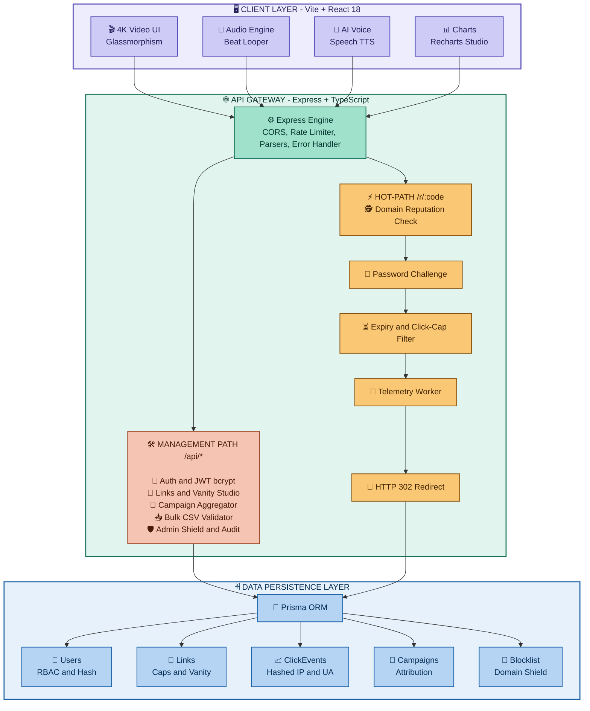
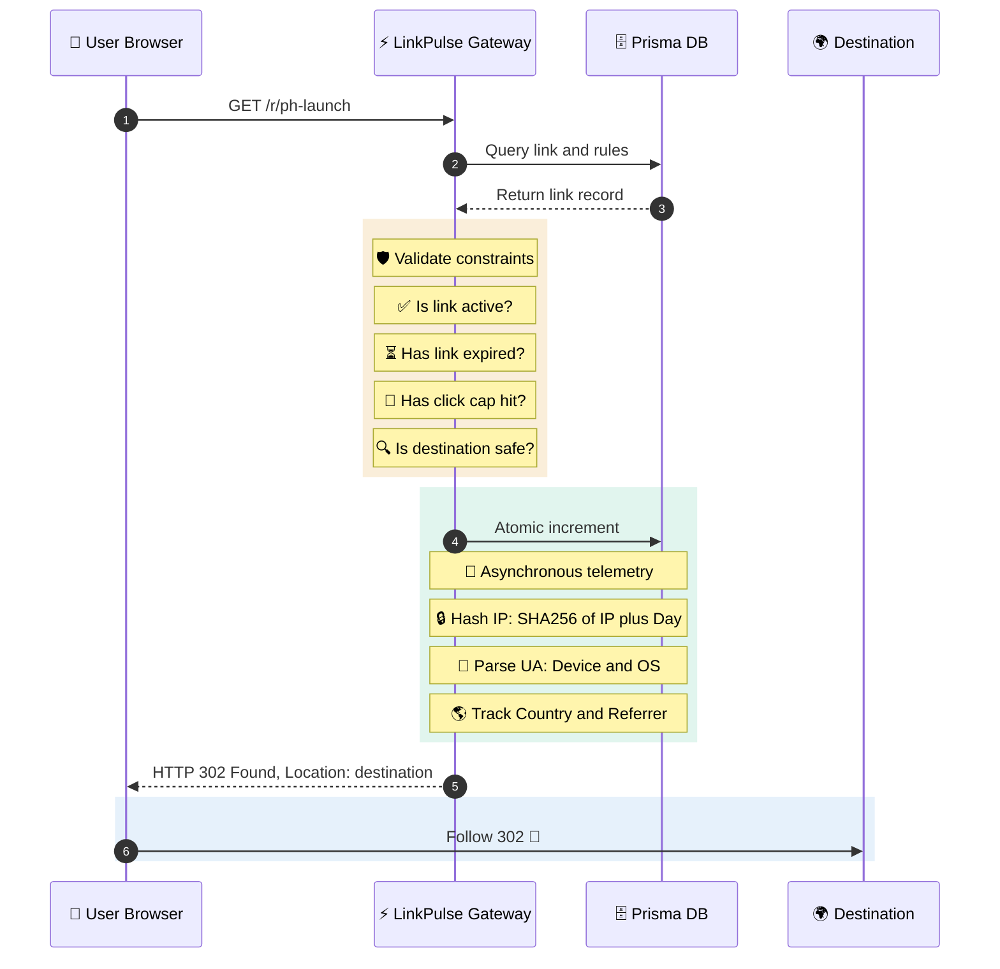
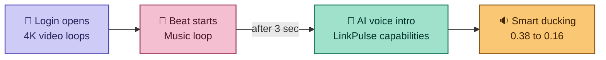
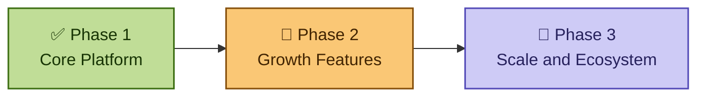
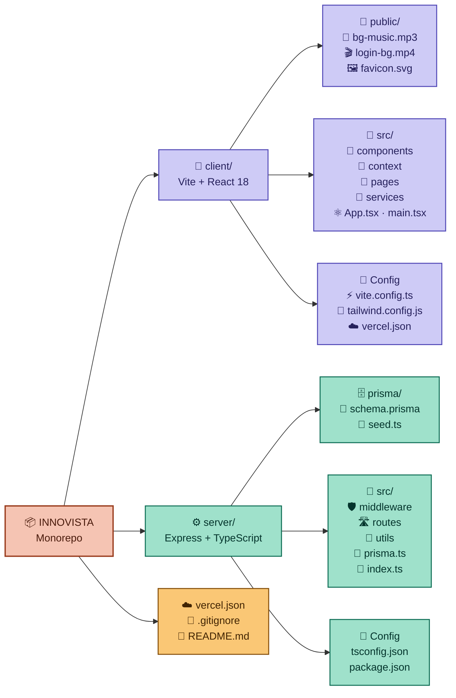
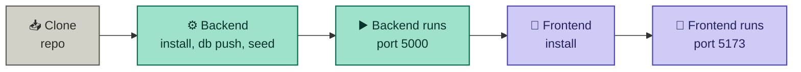
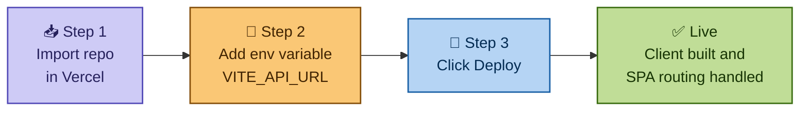

<div align="center">

# ⚡ LinkPulse (INNOVISTA)
### Enterprise Edge Link Infrastructure, Atomic Redirects & Real-Time Telemetry

[](https://react.dev/)
[](https://nodejs.org/)
[](https://www.prisma.io/)
[](https://tailwindcss.com/)
[](https://vercel.com/)
[](https://opensource.org/licenses/MIT)

<p align="center">
  <b>A production-grade, high-throughput URL infrastructure designed for ultra-low latency edge redirects, GDPR-compliant privacy analytics, cryptographic security barriers, dynamic vector QR generation, and autonomous AI voice telemetry.</b>
</p>

[Key Features](#-core-capabilities) • [System Architecture](#-system-architecture) • [Audio & AI Engine](#-multimedia--ai-audio-engine) • [API Reference](#-api-specification) • [Deployment](#-quickstart--deployment) • [Credentials](#-demo-credentials)

---

</div>


# Deployed Link ~ 

https://innovista-black.vercel.app/


# Prototype ~ 


# Dashboard ~ 


## 📌 Executive Summary

<div align="center">


</div>

> ### 💭 Modern link routing is more than a simple HTTP `302` redirect.
> Enterprise platforms require **atomic click enforcement**, **zero-latency destination lookup**, **fraud/malware domain screening**, **campaign attribution funnels**, and **deep privacy-preserving analytics**, all **without relying on invasive client-side cookies**.

<br/>

<div align="center">

### ⚡ LinkPulse is engineered as a resilient full-stack platform that delivers:

</div>

<table>
<tr>
<td width="20%" align="center" valign="top">

### ⚡
**Sub-15ms Hot-Path**


Redirection with **atomic click increments**

</td>
<td width="20%" align="center" valign="top">

### 🕵️
**Privacy-First Telemetry**


Daily salted **IP hashing** and User-Agent heuristic parsing

</td>
<td width="20%" align="center" valign="top">

### 🔳
**Vector QR Studio**


Scalable QR matrices with **scan-attribution tags**

</td>
<td width="20%" align="center" valign="top">

### 🛡️
**Automated Security Shield**


Domain reputation screening and **password-protected enclaves**

</td>
<td width="20%" align="center" valign="top">

### 🎙
**Immersive 4K Sci-Fi UI**


Web Audio synth loops and **Web Speech API** narration

</td>
</tr>
</table>

---
---

## 🏛 System Architecture



## ⚡ Redirection Sequence & Telemetry Lifecycle


## 🚀 Core Capabilities

<div align="center">


</div>

<br/>

<table>
<tr>
<td width="50%" valign="top">

### ⚡ 1. Sub-15ms Atomic Hot-Path
 

- 🧮 Optimized DB transactions give **atomic click counting** with zero race conditions during traffic spikes
- 🚧 **Hard-cap enforcement** blocks traffic the moment a link hits its limit
- ⏳ Temporary or permanent **expiry timestamps** stop stale URL forwarding

</td>
<td width="50%" valign="top">

### 🔐 2. Cryptographic Security Barrier
 

- 🔑 Gate sensitive destinations behind a **password challenge**
- 🪟 Branded **frosted-glass interstitial** is shown before forwarding
- 🛂 Only verified visitors reach the destination

</td>
</tr>
<tr>
<td width="50%" valign="top">

### 🕵️ 3. GDPR-Compliant Privacy Telemetry
 

- 🚫 **Zero raw PII storage**: IPs are never saved in plain text
- 🔒 One-way hash `SHA-256(IP + SALT + Date)` counts **unique visitors** without cross-session tracking
- 📱 User-Agent parser detects **Desktop, Mobile, Tablet, Bot**, OS and browser engine

</td>
<td width="50%" valign="top">

### 🔳 4. Dynamic Vector & Raster QR Studio
 

- 🎨 Live rendering of high-precision **SVG** and high-resolution **PNG** QR codes
- 🏷️ Embedded **scan attribution** (`?src=qr`) separates physical scans from digital clicks
- 📥 Download ready for print or web

</td>
</tr>
<tr>
<td width="50%" valign="top">

### 🎯 5. Multi-Channel Campaign Funnels
 

- 🗂️ Organize links into campaigns like `Q4 Launch`, `Black Friday`, `Influencer Outreach`
- 📊 Compare **traffic and conversion** performance across distribution channels

</td>
<td width="50%" valign="top">

### 📥 6. High-Speed Bulk CSV Ingestion
 

- 📄 Upload multi-column CSV files with **thousands of target URLs**
- ✅ Client-side matrix checks syntax and detects **duplicate aliases**
- 🧾 Formatting errors are reported **before submission**

</td>
</tr>
<tr>
<td colspan="2" valign="top">

### 🛡️ 7. Automated Domain Shield
 

- 🚫 Platform-wide blocklist keeps **phishing, malware and scam domains** out of the redirection pipeline
- 👑 Admins can add malicious domains instantly from the Admin panel

</td>
</tr>
</table>

---
## 🎙 Multimedia & AI Audio Engine

<div align="center">


*LinkPulse ke **Login** aur **Onboarding** views mein ek immersive audio-visual layer hai.*

</div>

### 🔄 How it works



### 🧩 Feature breakdown

<table>
<tr>
<td width="50%" valign="top">

#### 🌌 4K Cosmic Background
 

- 🛠️ **Tech:** Native HTML5 Video Canvas with hardware-accelerated CSS filters (`contrast`, `saturate`, `brightness`)
- ✨ **Behavior:** Continuous seamless loop with trailing **3-second auto-trim**

</td>
<td width="50%" valign="top">

#### 🎵 Trap Beat Looper
 

- 🛠️ **Tech:** Custom HTML5 Audio Engine (`/bg-music.mp3`)
- ✨ **Behavior:** Auto-loops continuously, with a precision **40ms interval** that crops the last 3 seconds to keep the rhythm tight

</td>
</tr>
<tr>
<td width="50%" valign="top">

#### 🤖 Autonomous AI Voice
  

- 🛠️ **Tech:** Browser Web Speech API (`SpeechSynthesisUtterance`)
- ✨ **Behavior:** Calm AI narration introducing LinkPulse capabilities **3 seconds after the music starts**

</td>
<td width="50%" valign="top">

#### 🔉 Smart Audio Ducking
 

- 🛠️ **Tech:** Dynamic gain and volume scaling (`0.38` ➔ `0.16`)
- ✨ **Behavior:** Music volume drops during AI narration so the voice stays **crystal clear**

</td>
</tr>
<tr>
<td colspan="2" valign="top">

#### 🔇 Sound State Protection
 

- 🛠️ **Tech:** Memory-backed `isMutedRef` plus gesture event lifecycle
- ✨ **Behavior:** Clicking **"Sound Off"** cleanly stops playback and prevents accidental auto-resumption

</td>
</tr>
</table>

---
## 🛠 Tech Stack Specification

<div align="center">


</div>

<br/>

<table>
<tr>
<td width="50%" valign="top">

### 🎨 Frontend

| | Technology | Details |
|:---:|:---|:---|
| ⚛️ |  | **Framework:** React 18.3 with TypeScript |
| ⚡ |  | **Bundler:** Vite 8.3 |
| 🎨 |  | **Styling:** Tailwind CSS, PostCSS, custom glassmorphism theme |
| 📊 |  | **Charts:** Area, Bar, Pie, Responsive Containers |
| 🔷 |  | **Icons:** Lucide React |
| 🌐 |  | **HTTP:** Axios with automated JWT auth interceptors |

</td>
<td width="50%" valign="top">

### ⚙️ Backend

| | Technology | Details |
|:---:|:---|:---|
| 🟢 |  | **Runtime:** Node.js v18+ |
| 🚂 |  | **Framework:** Express.js with TypeScript |
| 💎 |  | **ORM:** Prisma v5+ |
| 🗄️ |  | **Database:** SQLite (dev) / PostgreSQL (prod-ready) |
| 🔐 |  | **Security:** JWT, bcryptjs (salt factor 10), Express Rate Limiter |
| 📡 |  | **Telemetry:** UAParser.js, Node.js Crypto (SHA-256) |

</td>
</tr>
</table>

---
### 🗺 Roadmap

<div align="center">


</div>



### ✅ Phase 1: Core Platform (Completed)

| Status | Feature | Description |
|:---:|:---|:---|
|  | ⚡ **Atomic Redirects & Click Telemetry** | Sub-15ms hot-path with privacy-first analytics |
|  | 🔳 **QR Studio** | SVG and PNG QR codes with scan attribution |
|  | 🎯 **Campaigns & Bulk CSV Import** | Campaign funnels and validated batch uploads |
|  | 🛡️ **Admin Domain Shield** | Platform-wide malicious domain blocklist |
|  | 🎙 **AI Voice & Cinematic UI** | 4K video, beat looper and AI narration |

### 🚧 Phase 2: Growth Features (Upcoming)

| Status | Feature | Description |
|:---:|:---|:---|
|  | 🌐 **Custom Domains** | Use your own domain for short links |
|  | 👥 **Team Workspaces & Invites** | Collaborate with roles and permissions |
|  | 🗺️ **Geo-Location Map Analytics** | Visual world map of clicks |

### 🔮 Phase 3: Scale & Ecosystem (Future)

| Status | Feature | Description |
|:---:|:---|:---|
|  | 🔑 **Public API Keys & Webhooks** | Let developers integrate LinkPulse |
|  | 🔗 **Link-in-Bio Pages** | Personal landing pages with multiple links |

---

<div align="center">

💡 **Koi idea ya feature request hai?** [Open an issue](https://github.com/ujjwalchaudharyyy/INNOVISTA/issues) ya Pull Request bhejo!

</div>


## 📂 Project Directory Structure




## 📡 API Specification

<div align="center">


&nbsp;│&nbsp;


</div>

### 🔐 Authentication

| Method | Endpoint | Access | What it does |
|:---:|:---|:---:|:---|
|  | `/api/auth/register` |  | 📝 Create new account with hashed password |
|  | `/api/auth/login` |  | 🔑 Authenticate user & return signed JWT |
|  | `/api/auth/me` |  | 👤 Fetch current user session profile |

### ⚡ Redirect Engine (Hot-Path)

| Method | Endpoint | Access | What it does |
|:---:|:---|:---:|:---|
|  | `/r/:code` |  | 🚀 **Hot-path**: process redirect, record telemetry, return `302` |
|  | `/r/:code/verify` |  | 🔒 Verify password for protected links |

### 🔗 Links Management

| Method | Endpoint | Access | What it does |
|:---:|:---|:---:|:---|
|  | `/api/links` |  | 📋 List all active links of current user |
|  | `/api/links` |  | ✨ Create short link with optional rules & campaign |
|  | `/api/links/:id` |  | ✏️ Update destination, click-cap or expiry |
|  | `/api/links/:id` |  | 🗑️ Deactivate / remove link |

### 📊 Analytics & Campaigns

| Method | Endpoint | Access | What it does |
|:---:|:---|:---:|:---|
|  | `/api/analytics/overview` |  | 📈 Total clicks, top link, device breakdown |
|  | `/api/analytics/:id` |  | 🔍 Granular timeseries for a single link |
|  | `/api/campaigns` |  | 🎯 List campaigns with aggregated metrics |
|  | `/api/campaigns` |  | 🏷️ Create marketing campaign grouping |

### 📥 Bulk Import

| Method | Endpoint | Access | What it does |
|:---:|:---|:---:|:---|
|  | `/api/bulk/import` |  | 📦 Ingest & validate batch CSV link entries |

### 👑 Admin Shield

| Method | Endpoint | Access | What it does |
|:---:|:---|:---:|:---|
|  | `/api/admin/metrics` |  | 🛰️ Platform-wide traffic & infrastructure stats |
|  | `/api/admin/blocklist` |  | 🚫 Add domain to malicious blocklist |

---

## 🚀 Quickstart & Deployment

<div align="center">


</div>

### 📋 Prerequisites

<table>
<tr>
<td width="50%" align="center">

### 🟢 Node.js


Check karo: `node -v`

</td>
<td width="50%" align="center">

### 📦 npm


Check karo: `npm -v`

</td>
</tr>
</table>

### 💻 Local Development Setup



#### 📥 Step 0: Clone the repository

```bash
git clone https://github.com/ujjwalchaudharyyy/INNOVISTA.git
cd INNOVISTA
```

---

#### ⚙️ Step 1: Backend Server Setup
 

```bash
# Navigate to server directory
cd server

# Install dependencies
npm install

# Push Prisma schema to local database
npx prisma db push

# Seed realistic demo data (users, campaigns, links, analytics events)
npx tsx prisma/seed.ts

# Start backend server in development mode
npm run dev
```

> ✅ **Server will be available at:** [`http://localhost:5000`](http://localhost:5000)

---

#### 🎨 Step 2: Frontend Client Setup
 

```bash
# Open a new terminal and navigate to client directory
cd client

# Install dependencies
npm install

# Launch Vite development server
npm run dev
```

> ✅ **Frontend will be available at:** [`http://localhost:5173`](http://localhost:5173)

---

### 🎉 You're all set!

<div align="center">

| Service | URL | Status |
|:---:|:---:|:---:|
| ⚙️ **Backend API** | `http://localhost:5000` |  |
| 🎨 **Frontend App** | `http://localhost:5173` |  |

🔑 Login ke liye [Demo Credentials](#-demo-credentials) use karo.

</div>

---
## ☁️ 1-Click Vercel Deployment

<div align="center">

[](https://vercel.com/new/clone?repository-url=https://github.com/ujjwalchaudharyyy/INNOVISTA)


*LinkPulse mein root aur client dono jagah `vercel.json` pehle se configured hai, isliye **zero-configuration deployment** hota hai.*

</div>



<table>
<tr>
<td width="33%" valign="top" align="center">

### 📥 Step 1
**Import Repository**

Apni **[Vercel Dashboard](https://vercel.com/new)** mein ye repository import karo.

</td>
<td width="33%" valign="top" align="center">

### 🔧 Step 2
**Environment Variables**

Vercel mein variable configure karo (neeche table dekho).

</td>
<td width="33%" valign="top" align="center">

### 🚀 Step 3
**Click Deploy**

Vercel khud **client build** karega aur **SPA routing** seamlessly handle karega.

</td>
</tr>
</table>

### 🔧 Environment Variables

| Variable | Required | Description | Example |
|:---:|:---:|:---|:---|
| `VITE_API_URL` |  | Tumhara hosted **backend URL** | `https://your-api.onrender.com` <br/> `https://api.yourdomain.com` |

> 💡 **Tip:** Backend alag deploy karna hota hai (jaise Render par). Pehle backend ka URL lo, phir use `VITE_API_URL` mein daalo.

**🌐 Live deployment:** 👉 [**innovista-black.vercel.app**](https://innovista-black.vercel.app/)

---

## 🔑 Demo Credentials

<div align="center">


*Platform evaluate karne ke liye pehle se banaye gaye login credentials.*

</div>

<table>
<tr>
<td width="50%" valign="top">

### 👤 Standard User
 

| | |
|:---|:---|
| 📧 **Email** | `demo@linkpulse.io` |
| 🔒 **Password** | `Demo@123456` |

**✅ Permissions**
- 🔗 Full link creation
- 🎯 Campaigns
- 🔳 QR Studio
- 📥 Bulk CSV
- 📊 Analytics

</td>
<td width="50%" valign="top">

### 👑 Administrator
 

| | |
|:---|:---|
| 📧 **Email** | `admin@linkpulse.io` |
| 🔒 **Password** | `Admin@123456` |

**✅ Permissions**
- ✨ All user capabilities
- 🛡️ Admin Shield
- 🚫 Domain blocklists
- 🛰️ Platform metrics

</td>
</tr>
</table>

<div align="center">

[](https://innovista-black.vercel.app/)

</div>

---

## Local Setup !


## 📄 License

This project is licensed under the **MIT License** — see the [LICENSE](LICENSE) file for details.

<div align="center">
  <sub>Built with precision for high-scale link infrastructure. LinkPulse © 2026.</sub>
</div>


## 👥 Meet Team Tech4All

<div align="center">

### 👑 Team Leader

<a href="https://github.com/ujjwalchaudharyyy">
  <br/>
  <b>Ujjwal Chaudhary</b>
</a><br/>
<sub>🚩 Team Leader</sub>

<br/><br/>

### 🤝 Team Members

<table>
  <tr>
    <td align="center" width="200">
      <a href="https://github.com/vaibhavi123-p">
        <br/>
        <b>Vaibhavi Pandey</b>
      </a><br/>
      <sub>Team Member</sub>
    </td>
    <td align="center" width="200">
      <a href="https://github.com/Tushar-Gahlout">
        <br/>
        <b>Tushar Gahlout</b>
      </a><br/>
      <sub>Team Member</sub>
    </td>
    <td align="center" width="200">
      <a href="https://github.com/sumitsanwal07">
        <br/>
        <b>Sumit Sanwal</b>
      </a><br/>
      <sub>Team Member</sub>
    </td>
    <td align="center" width="200">
      <a href="https://github.com/sapna-bisht0103">
        <br/>
        <b>Sapna Bisht</b>
      </a><br/>
      <sub>Team Member</sub>
    </td>
  </tr>
</table>

</div>

